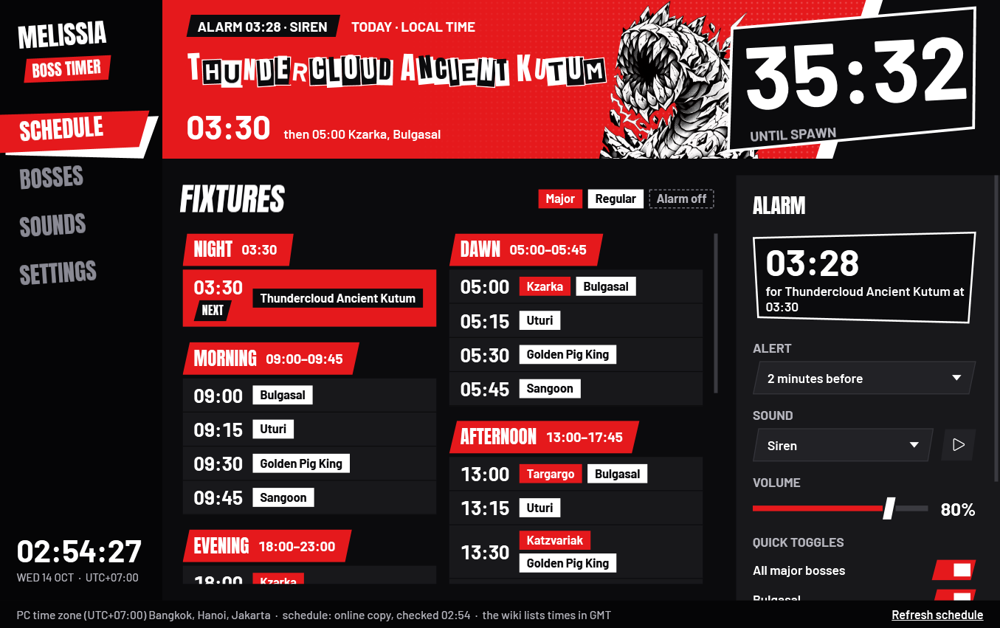
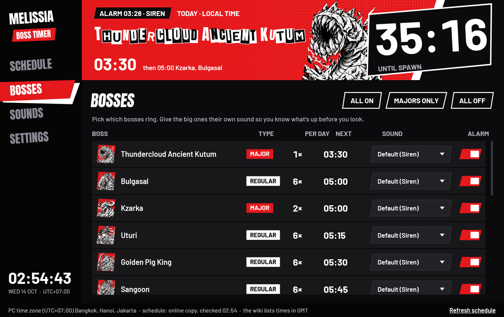
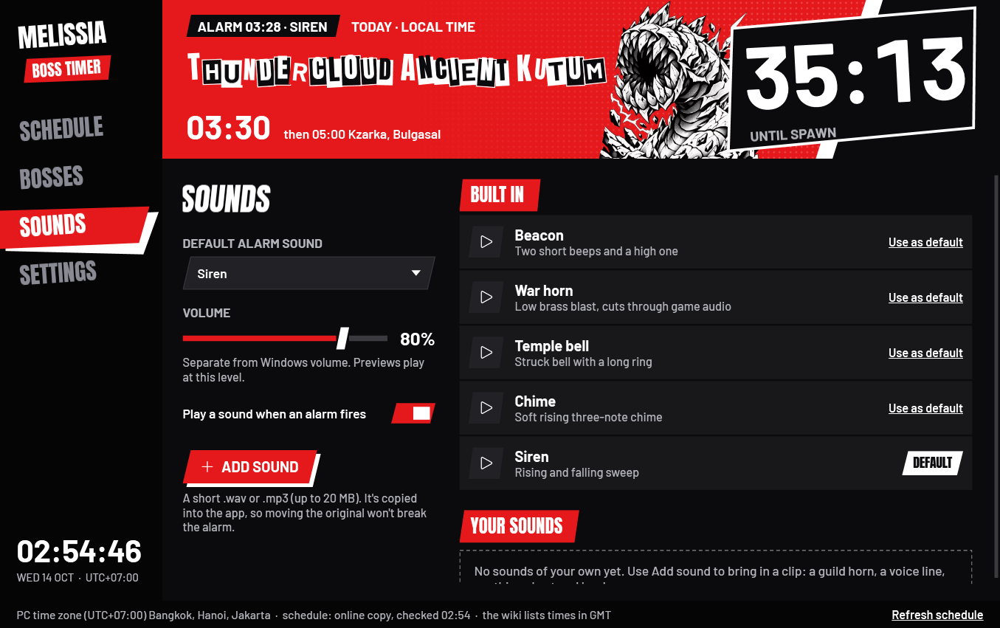
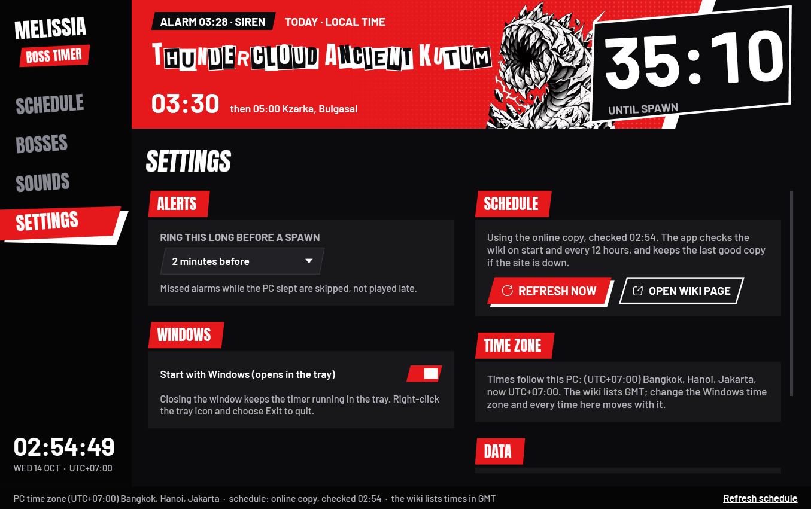
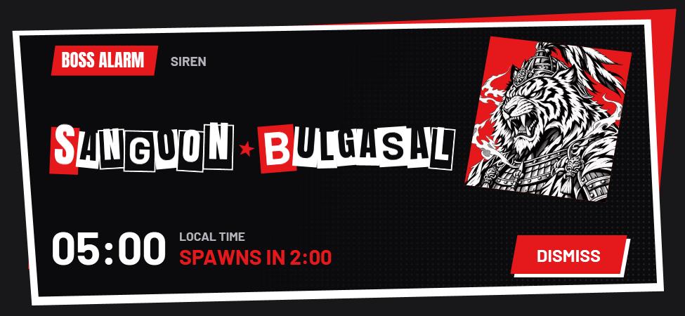
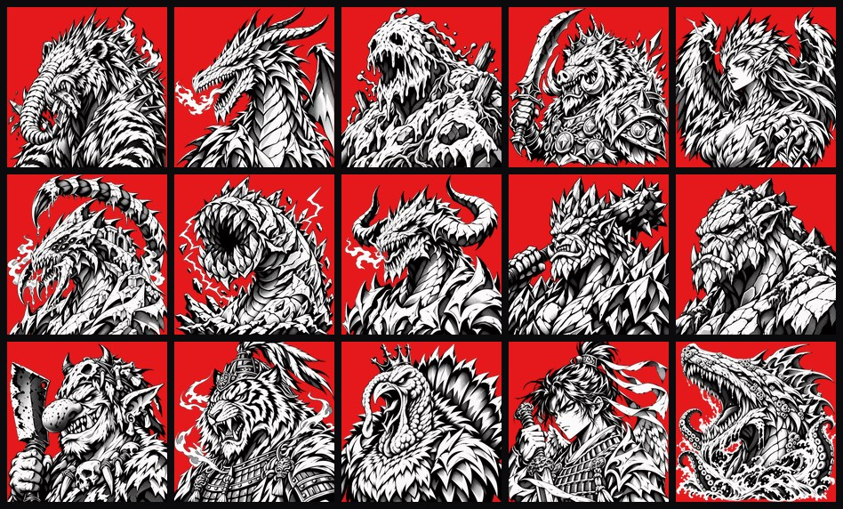

<p align="center">
  
</p>

<h1 align="center">Melissia Boss Timer</h1>

<p align="center">
  A Windows tray alarm for Melissia world bosses, in <b>your PC's own time zone</b>.<br>
  The next spawn is billed like a match fixture, styled in a Persona 5-inspired red-and-black.
</p>

<p align="center">
  <a href="https://github.com/aikazu/melissia-boss-timer/releases/latest"><b>Download the latest release</b></a>
  &nbsp;·&nbsp; Windows 10/11 x64 &nbsp;·&nbsp; single exe, no install
</p>



## Why

The [wiki boss schedule](https://melissiagamesinfohub.vercel.app/en/wiki/boss-schedule) lists spawns in GMT, so everyone does the time-zone math in their head. This app keeps every spawn in UTC and converts it with whatever time zone Windows is set to. The same exe shows the right times on a GMT+7 PC, a GMT+3 PC, or a PC that observes daylight saving. Change the Windows time zone while it's running and every time moves with it.

## Features

- **On air:** the next boss's name in ransom-note letters, with its portrait, local spawn time and a live countdown. The day's spawns are grouped into Night, Dawn, Morning, Afternoon and Evening.
- **Alarm before spawn:** pick 0 to 30 minutes. When it fires you get a looping sound, a topmost "calling card" popup and a tray notification. Alarms missed while the PC slept are skipped, not played late.
- **Per-boss control:** turn each boss's alarm on or off, or use "majors only", and give the big ones their own sound.
- **Sounds:** five built-in tones, or bring your own `.wav` or `.mp3` (up to 20 MB, copied into the app). Preview any of them, pick a default, and set a volume separate from Windows.
- **Always current:** the schedule refreshes from the wiki at start-up and every 12 hours. If the wiki is down, the app falls back to the last good copy, then to a built-in snapshot.
- **Stays out of the way:** closing the window keeps it in the tray, and it can optionally start with Windows (minimized).

| Bosses | Sounds |
|---|---|
|  |  |
| **Settings** | **Alarm** |
|  |  |

## Install

1. Download `MelissiaBossTimer.exe` from the [latest release](https://github.com/aikazu/melissia-boss-timer/releases/latest).
2. Run it. It's a self-contained single file, so no .NET install is needed.
3. The exe is unsigned, so on a new PC SmartScreen may say "Windows protected your PC". Choose **More info → Run anyway**.

Settings, your sounds and the cached schedule live in `%LOCALAPPDATA%\MelissiaBossTimer\`.

## Boss art



The 15 portraits are **original interpretations** made for this app from public descriptions of each boss. They are not official game art. Variants share their base boss's art (Stormbringer Karanda, Thundercloud Ancient Kutum), and a boss the app has no art for shows its initial instead.

Each PNG in `src/MelissiaBossTimer/Assets/Bosses/` carries its generation prompt as embedded metadata, and `art/prompts.py` has the full set. To regenerate them:

1. Put new transparent PNGs in `art/raw/`.
2. Run `python tools/process_boss_art.py`. It trims, squares and sizes them to 512 px.
3. Run `python tools/embed_boss_provenance.py <impeccable.exe>` to re-embed the prompts.

## Build from source

Requires the .NET 10 SDK.

```
dotnet test
dotnet publish src/MelissiaBossTimer -c Release -o publish
```

`publish/MelissiaBossTimer.exe` is the self-contained single file.

| Path | What's in it |
|---|---|
| `src/MelissiaBossTimer.Core` | Schedule, time-zone conversion, alarm planning, wiki parser, sounds and settings (no UI) |
| `src/MelissiaBossTimer` | The WPF app: window, pages, alarm popup, tray icon, theme |
| `tests/MelissiaBossTimer.Tests` | xUnit tests: GMT+7 day rollover, DST, parser fixture, alarms, sounds, settings, boss art |
| `tools/` | Icon and boss-art pipelines |
| `DESIGN.md`, `PRODUCT.md` | Design system and product brief |

## Notes

- Every row in the wiki table is treated as a daily spawn, because the page has no day-of-week column.
- If the game runs in exclusive fullscreen, Windows may hide notifications and popups. The sound still plays.
- Fonts: Anton, Barlow and Barlow Condensed are bundled under the SIL Open Font License (`src/MelissiaBossTimer/Fonts/`).
- This is a fan-made tool. The Persona-style look is an homage, and the project is not affiliated with Atlus, Pearl Abyss or Melissia Games.
